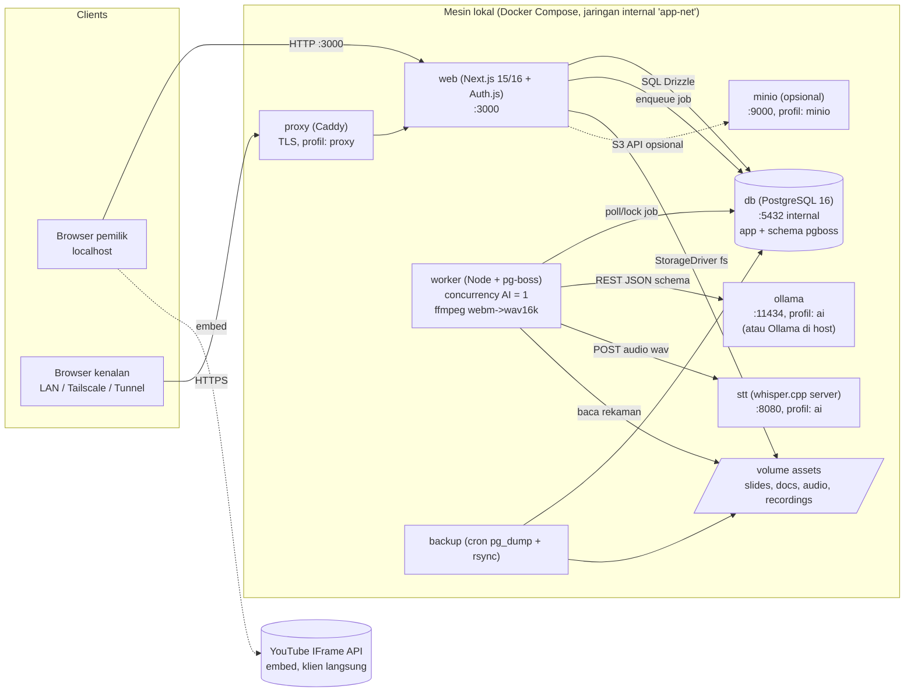
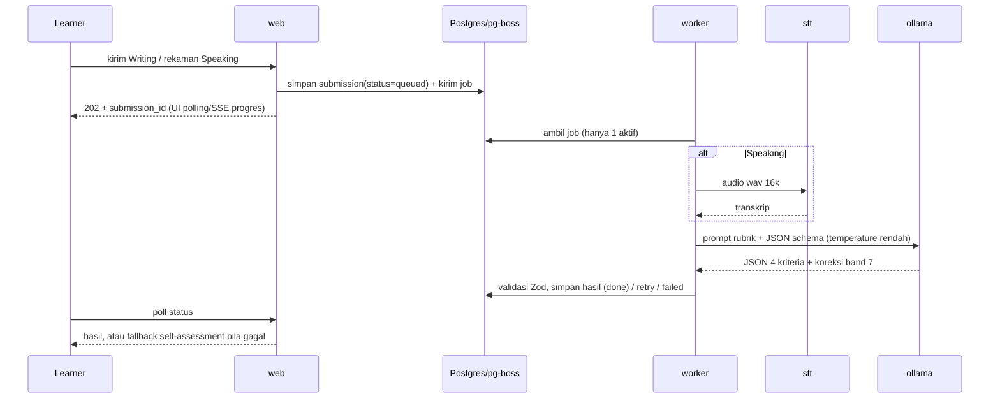

# INFRASTRUCTURE ARCHITECTURE: ielts-learning-platform

**Owner Agent:** SysArch
**Date:** 2026-11-03
**Status:** `Approved` (didelegasikan, lihat ADR-003)
**WORK_DEPTH:** standard
**Dokumen terkait:** `current_state.md`, `capacity_planning.md`, `../decisions/ADR-001-local-docker-compose-topology.md`, `../decisions/ADR-002-ai-runtime-and-model-tiering.md`

## 1. Prinsip
1. Full lokal, biaya nol, satu mesin, tanpa API berbayar.
2. Satu perintah `docker compose up` untuk pengembangan; profil Compose untuk komponen opsional (`ai`, `minio`, `proxy`).
3. Semua dependensi eksternal bisa diganti lewat env (`OLLAMA_BASE_URL`, `STT_BASE_URL`, `STORAGE_DRIVER`) sehingga Ollama/STT bisa berjalan di host (mis. GPU Windows) tanpa mengubah kode.
4. Satu job AI aktif (concurrency pg-boss = 1 untuk antrean `ai`), UI tidak boleh terblokir inferensi.
5. Skema DB kompatibel Supabase kelak; storage lewat abstraksi `StorageDriver`.

## 2. Diagram Arsitektur

### Alur penilaian AI (asinkron)

## 3. Daftar Servis Compose
| Servis | Image / basis | Port | Volume | Profil | RAM batas (usulan) | Catatan |
|---|---|---|---|---|---|---|
| `db` | `postgres:16-alpine` | 5432 (hanya internal; publish ke 127.0.0.1 saat dev) | `pgdata` | default | 1,5 GB | `shared_buffers=256MB`, `max_connections=50`, healthcheck `pg_isready` |
| `web` | Dockerfile multi-stage Node 22 (`output: standalone`) | 3000 | `assets` (rw) | default | 1 GB | Migrasi Drizzle dijalankan sebagai job `migrate` sekali jalan sebelum web |
| `worker` | image sama dengan web, entrypoint worker | tidak ada | `assets` (rw) | default | 768 MB | pg-boss, ffmpeg ada di image; `teamSize/concurrency=1` untuk antrean `ai` |
| `ollama` | `ollama/ollama` | 11434 (internal) | `ollama_models` | `ai` | tidak dibatasi keras (tergantung model) | GPU: `deploy.resources.reservations.devices` (NVIDIA) |
| `stt` | image whisper.cpp server (diverifikasi saat spec 000) | 8080 (internal) | `whisper_models` | `ai` | 1,5 GB | Model `base` atau `small`, ukuran dipilih via env |
| `minio` | `minio/minio` | 9000/9001 | `minio_data` | `minio` | 512 MB | Hanya bila ADR storage berubah; `STORAGE_DRIVER=s3` |
| `proxy` | `caddy:2` | 80/443 | `caddy_data` | `proxy` | 128 MB | TLS untuk akses non-localhost (wajib untuk mikrofon, lihat 5) |
| `backup` | `postgres:16-alpine` + cron | tidak ada | `backups`, `assets` (ro) | default | 128 MB | `pg_dump` harian, retensi 14 harian + 8 mingguan |

Jaringan: satu bridge `app-net`; hanya `proxy` (atau `web` saat dev) yang mempublikasikan port ke host. Postgres, Ollama, STT, MinIO tidak diekspos ke LAN.

Urutan start: `db` (healthy) -> `migrate` -> `web`, `worker`; `worker` tidak bergantung keras pada `ollama`/`stt` (cek kesiapan saat job; bila tidak siap, job di-retry dengan backoff dan UI menampilkan status).

### Variabel lingkungan inti (nama, bukan nilai)
`DATABASE_URL`, `AUTH_SECRET`, `AUTH_URL`, `ASSETS_DIR`, `STORAGE_DRIVER` (`fs`|`s3`), `S3_*` (bila MinIO), `OLLAMA_BASE_URL`, `OLLAMA_MODEL_WRITING`, `OLLAMA_MODEL_SPEAKING`, `OLLAMA_KEEP_ALIVE`, `STT_BASE_URL`, `STT_MODEL`, `AI_JOB_TIMEOUT_SEC`, `AI_DAILY_LIMIT_PER_USER`, `UPLOAD_MAX_MB`, `AUDIO_RETENTION_DAYS`. Rahasia disimpan di `.env` (tidak di-commit); sediakan `.env.example` tanpa nilai nyata.

## 4. Penyimpanan Aset
- **Default:** filesystem pada volume `assets`, struktur `assets/{public|private}/...`. `public/` (slide, dokumen) disajikan lewat route handler yang menyetel cache header panjang; `private/` (rekaman Speaking) hanya lewat route terotorisasi (cek pemilik atau admin), tidak pernah sebagai static publik.
- Abstraksi `StorageDriver { put, getStream, delete, signedUrl? }` dengan implementasi `fs` dan `s3` (MinIO). Pindah ke MinIO tidak mengubah kode domain, hanya env dan migrasi file.
- Validasi unggahan: tipe MIME + magic bytes, batas ukuran (`UPLOAD_MAX_MB`, usulan 10 MB audio, 25 MB dokumen), nama file di-generate (UUID), tanpa path dari klien.
- Metadata tiap aset mencatat `source` dan `license` (kewajiban R4).
- Retensi: rekaman mentah dihapus oleh job terjadwal setelah `AUDIO_RETENTION_DAYS` (usulan 90).

## 5. Opsi Akses (Open Question 2)
Penting: **perekaman mikrofon (Speaking) via `getUserMedia` hanya berjalan pada secure context** (HTTPS atau `localhost`). Akses `http://192.168.x.x:3000` dari perangkat kenalan akan membuat perekam Speaking gagal. Jadi akses non-localhost memerlukan HTTPS.

| Opsi | Cara | HTTPS | Biaya | Keamanan | Kesesuaian |
|---|---|---|---|---|---|
| A. Localhost saja | `http://localhost:3000` | ya (secure context) | 0 | terbaik | Pemilik saja; fase awal/dev |
| B. LAN + HTTPS lokal | Caddy dengan CA lokal (mkcert/`tls internal`), IP/hostname tetap, firewall Windows hanya subnet LAN | ya, tapi tiap perangkat harus memasang CA | 0 | baik (tidak ke internet) | Kenalan serumah/satu Wi-Fi; instal CA merepotkan |
| C. Tailscale (rekomendasi untuk kenalan jarak jauh) | `tailscale serve` / Caddy; kenalan memasang Tailscale dan diundang ke tailnet | ya (sertifikat MagicDNS otomatis) | 0 (paket Personal, batas perangkat berlaku, cek syarat terkini) | sangat baik (privat, WireGuard) | <50 user terkontrol; tiap orang perlu instal app |
| D. Cloudflare Tunnel + Access | `cloudflared` ke domain milik sendiri; Cloudflare Access (OTP email) di depan | ya | tunnel gratis; domain berbayar (~Rp150-200 rb/tahun) | baik jika Access aktif; tanpa Access = publik | Kenalan tanpa instal apa pun; perlu domain dan menimbulkan pertimbangan UU PDP |
| E. ngrok/tunnel sementara | URL acak | ya | gratis dengan batas | URL publik | Demo singkat saja |

**Rekomendasi:** fase pengembangan = A. Rilis pribadi ke kenalan = C (Tailscale) jika kenalan bersedia memasang app, atau D bila harus tanpa instal. Pada B/C/D wajib: `AUTH_URL` sesuai host publik, cookie `Secure`, rate-limit login, dan firewall hanya mengizinkan port proxy. Keputusan ini bagian dari OQ-2 dan **tidak mengunci desain**: proxy Caddy sama untuk semua opsi.

Keterbatasan semua opsi: mesin harus menyala dan tidak sleep saat dipakai (gunakan `request_keep_awake`/pengaturan daya host); tidak ada HA.

## 6. Keputusan Model AI berdasarkan RAM/GPU (belum diketahui)
Mesin sasaran belum diketahui, sehingga model **tidak dikunci**. Desain: konfigurasi lewat env + skrip benchmark + matriks keputusan berikut. Dasar angka: `capacity_planning.md` 2.3 dan 2.4 (estimasi, bukan benchmark).

| Kondisi mesin | LLM (Writing/Speaking) | STT | Hasil perkiraan | Catatan |
|---|---|---|---|---|
| RAM <8 GB, tanpa GPU | tidak disarankan lokal; pakai mode self-assessment + rubrik, AI dinonaktifkan (`AI_ENABLED=false`) | `base` (opsional) | n/a | R6 terpicu; aplikasi non-AI tetap penuh |
| RAM 8 sampai 12 GB, tanpa GPU | kelas 3B Q4 (mis. Llama 3.2 3B / Qwen2.5 3B Instruct) | whisper `base` | Writing ~30 sampai 80 dtk, kualitas skor rendah-menengah | Tier A |
| RAM >=16 GB, tanpa GPU | kelas 7/8B Q4 (Qwen2.5 7B / Llama 3.1 8B) | whisper `small` | Writing ~1 sampai 4 menit; kualitas baik tapi melampaui target 60 dtk | Tier B; terima waktu tunggu atau pilih 3B untuk Speaking |
| NVIDIA >=8 GB VRAM | 7/8B Q4 penuh di GPU | whisper `small` (opsional CUDA) | ~10 sampai 25 dtk | Tier C; jalankan Ollama di host Windows bila passthrough Docker bermasalah |
| NVIDIA >=12 GB VRAM | 7/8B Q8 atau model 14B Q4 | whisper `small`/`medium` | ~15 sampai 40 dtk, kualitas terbaik | Opsional |
| GPU AMD/Intel | Ollama native di host (ROCm/Vulkan sesuai dukungan terkini); tidak lewat Docker | `base`/`small` CPU | bervariasi | Verifikasi dukungan saat benchmark |

Proses penetapan (dilakukan sebelum spec AI grader): (1) human menjawab OQ-1 (CPU, RAM, GPU/VRAM, disk bebas); (2) skrip `scripts/bench-ai.mjs` menjalankan 3 esai contoh Band 5/6/7 dan 1 rekaman 2 menit pada kandidat model, mencatat latensi dan stabilitas JSON; (3) pilih model terkecil yang lolos: JSON schema valid >=95 persen dan latensi dalam target atau disetujui human. Ganti model hanya perlu mengubah env, bukan kode (ADR-002).

Mitigasi kualitas yang tidak bergantung ukuran model: output JSON terstruktur dengan schema, temperature rendah (0 sampai 0,3), few-shot esai Band terkalibrasi, validasi Zod dengan 1 retry perbaikan, disclaimer "perkiraan", dan batas keluaran token.

## 7. Spesifikasi per Lingkungan
| Lingkungan | Tujuan | Spesifikasi | Deployment | Biaya |
|---|---|---|---|---|
| Development | Coding, test, debug | Mesin pemilik; dev boleh tanpa servis `ai` (mock LLM/STT via env) untuk menghemat RAM; minimal 8 GB bila AI mock, 16 GB bila AI nyata | `docker compose up` (+ `--profile ai`) atau `npm run dev` dengan DB di Docker | 0 |
| Staging | UAT/demo | Tidak ada lingkungan terpisah; gunakan stack Compose kedua dengan project name dan port berbeda (`docker compose -p ielts-stg`), DB dan volume terpisah, di mesin yang sama | Compose override `docker-compose.staging.yml` | 0 |
| Produksi (pribadi) | Dipakai pemilik dan kenalan | Mesin lokal Tier A/B/C (lihat capacity_planning 5); Compose profil `proxy` + `ai` + backup | Satu mesin, `restart: unless-stopped` | 0 (listrik; domain opsional bila opsi D) |

Tidak ada Option 2 multi-server: tidak relevan pada <50 user dan batasan lokal.

## 8. Operasional
- **Monitoring:** healthcheck Compose tiap servis; endpoint `/api/health` (DB, antrean, Ollama, STT) untuk dashboard admin; log container dengan rotasi (`json-file` max-size 10m, max-file 3); metrik minimal antrean AI (jumlah menunggu, durasi p50/p95, kegagalan). Prometheus/Grafana tidak perlu.
- **Backup:** `pg_dump` harian (retensi 14 hari) dan mingguan (8 minggu) ke disk terpisah/drive eksternal; salinan `assets/private` dan `assets/public` (rsync incremental); volume model tidak dicadangkan (bisa diunduh ulang). Uji restore tiap kuartal. RPO 24 jam, RTO beberapa jam (tidak ada target uptime).
- **Update:** `docker compose pull && up -d`; migrasi Drizzle sebelum web; pin versi image (tidak `latest`) dan catat model Ollama dengan digest.
- **Skalabilitas:** vertikal saja (RAM/GPU). Pemicu evaluasi: antrean AI rata-rata >10 menit, concurrent >10, atau dibuka publik. Langkah berikut: GPU, lalu pisah mesin AI (set `OLLAMA_BASE_URL` ke mesin lain), baru pertimbangkan cloud.
- **Keamanan (standard):** Postgres/Ollama/STT/MinIO hanya di `app-net`; tidak ada port ke LAN selain proxy; container non-root; rahasia lewat `.env`; rate-limit login dan endpoint submission AI; batas ukuran unggahan; headers keamanan di Caddy/Next; pembaruan image berkala. Ollama tidak punya autentikasi sehingga jangan pernah dipublikasikan ke jaringan.
- **Disaster recovery:** (depth standard, ringkas) restore = pulihkan `.env`, `pgdata` dari dump terakhir, dan folder `assets`; model diunduh ulang. Tidak ada multi-region atau HA (di luar scope).

## 9. Open Questions (butuh human)
| ID | Pertanyaan | Dampak |
|---|---|---|
| OQ-1 | Spesifikasi mesin: CPU (model/core), RAM, GPU + VRAM, disk SSD bebas, OS (Windows 11 dengan Docker Desktop?). | Menentukan Tier A/B/C, model LLM/STT, dan apakah target 10 sampai 60 dtk tercapai |
| OQ-2 | Kenalan mengakses lewat apa: hanya localhost, satu LAN, Tailscale, atau Cloudflare Tunnel? Mesin menyala 24 jam atau hanya saat dipakai? | Pilihan opsi akses, profil `proxy`, domain |
| OQ-3 | Apakah terima waktu tunggu penilaian AI beberapa menit bila tanpa GPU (Tier B)? Atau pakai model 3B yang lebih cepat tapi kurang akurat? | Pilihan model, ekspektasi UX antrean |
| OQ-4 | Pakai Ollama di container atau native di host (terutama bila GPU)? Disarankan keputusan diambil setelah OQ-1 | Isi compose profil `ai` |
| OQ-5 | Lokasi dan media backup (drive eksternal / disk kedua / cloud pribadi gratis)? | Konfigurasi servis `backup` |
| OQ-6 | Retensi rekaman Speaking (usulan 90 hari) dan batas harian submission AI per pengguna (usulan 10)? | Kebijakan data, job pembersih |

## Revision History
| Timestamp | Agen | Perubahan |
|-----------|------|-----------|
| 2026-11-03 | SysArch | Dokumen dibuat |
