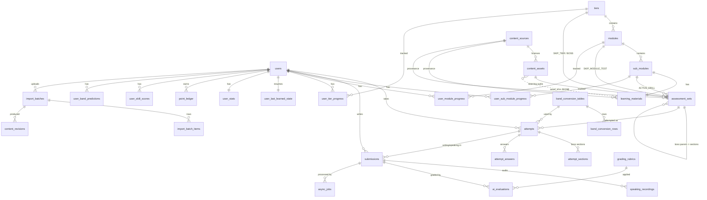

# DATA MODEL — ielts-learning-platform

**Owner Agent:** Data Architect
**Date:** 2026-11-03
**Phase:** Planning
**Status:** `Approved` (didelegasikan, lihat ADR-003)
**WORK_DEPTH:** `standard` (full schema + indeks + migrasi + governance ringkas yang proporsional untuk <50 pengguna, 1 mesin lokal)

> Acuan resmi struktur data proyek. Backend Engineer WAJIB mengikuti ini. Perubahan harus lewat `agent/workflows/_shared/change-management.md` (ADR + notifikasi Backend).
> Pendamping: [`schema.reference.ts`](./schema.reference.ts) = terjemahan Drizzle lengkap (tipe, constraint, indeks). Jika ada selisih antara dokumen ini dan file itu, dokumen ini yang berlaku dan file TS harus diperbaiki.
> Sumber: `project_overview.md`, `requirements.md` (Approved), PRD Gemini v1.0 (DDL 7.2, kontrak 7.3, konversi band 6).

---

## 1. Entity Overview

Database: **PostgreSQL 16** (Docker), ORM/migrasi **Drizzle + drizzle-kit** (disetujui), autentikasi **Auth.js Credentials** (disetujui), antrean **pg-boss** (disetujui). Semua PK `uuid` (`gen_random_uuid()` bawaan PG16, tanpa ekstensi) kecuali tabel log append-only (`bigserial`). Semua waktu `timestamptz` (UTC). Nama tabel `snake_case`, kolom Drizzle `camelCase` dipetakan ke `snake_case`.

Ringkasan 31 tabel dalam 9 kelompok. Tanda `[PRD]` = ada di DDL PRD 7.2 (diubah/diperluas), `[BARU]` = ditambahkan Data Architect.

| Kelompok | Tabel | Peran |
|---|---|---|
| **Auth** | `users` [BARU] | Akun, peran `learner`/`admin` (enum, bukan tabel `roles`; lihat D1), `password_hash`, lockout login |
| **Sumber & lisensi** | `content_sources` [BARU], `content_assets` [BARU] | Katalog sumber (NGSL, Tatoeba, OWN, YouTube, ...) + setiap aset fisik/tautan dengan status hak |
| **Kurikulum** | `tiers` [PRD+], `modules` [PRD+], `sub_modules` [PRD+], `learning_materials` [PRD+], `assessment_sets` [PRD+] | Hierarki Tier > Modul > Sub-Modul, materi multimodal, bank soal (JSONB) |
| **Progres & resume** | `user_tier_progress`, `user_module_progress` [BARU], `user_sub_module_progress` [PRD+], `user_last_learned_state` [PRD+] | Gatekeeping per level + posisi terakhir |
| **Konversi band** | `band_conversion_tables`, `band_conversion_rows` [BARU] | Tabel konversi sebagai data yang dapat diubah (A3/R5) |
| **Attempt & jawaban** | `attempts`, `attempt_sections`, `attempt_answers` [BARU] | Sesi ujian/drill, bagian Boss per skill, jawaban per soal |
| **Penilaian AI** | `grading_rubrics`, `submissions`, `speaking_recordings`, `ai_evaluations` [BARU] | Writing/Speaking, rekaman audio, transkrip, hasil Ollama |
| **Antrean** | `async_jobs` [BARU] (+ skema `pgboss` milik pg-boss) | Jembatan status job untuk polling UI |
| **Gamifikasi & analitik** | `user_stats`, `point_ledger`, `user_skill_scores`, `user_band_predictions` [BARU] | Poin, streak, mahkota (rekap), radar 6 sumbu, riwayat prediksi band |
| **Admin & tata kelola** | `import_batches`, `import_batch_items`, `content_revisions`, `audit_log`, `app_settings` [BARU] | Bulk import log, riwayat revisi konten, audit, ambang konfigurasi |

### Prinsip desain yang mengikat

1. **Soal tetap di JSONB** (`assessment_sets.questions_json`) sesuai PRD agar kontrak importer 7.3 stabil. Konsekuensinya identitas soal adalah `question_id` (string, unik di dalam satu set, divalidasi importer), bukan baris. Jawaban user disimpan per baris di `attempt_answers` dengan `question_id`.
2. **Referensi aset di JSONB memakai `asset_id` (uuid -> `content_assets`), bukan URL mentah.** Importer menerima `file_url`/`image_url` dari kontrak PRD lalu menyelesaikannya ke aset (membuat baris `content_assets` + wajib menyebut sumber). Dengan begitu lisensi dapat dilacak per aset dan tidak ada aset tanpa sumber.
3. **Materi berhak cipta tidak pernah disimpan** (R4). Ditegakkan di tingkat skema (bagian 5.1), bukan hanya prosedur.
4. **Konfigurasi gerbang/konversi adalah data**, bukan konstanta kode: ambang 75/85/80, tabel band, mahkota (`app_settings`), rubrik AI.
5. **Hasil ujian dapat direproduksi**: attempt menyimpan `assessment_version` dan `band_table_id` yang dipakai; edit konten atau penggantian tabel band setelahnya tidak mengubah riwayat.

## 2. Entity Relationship Diagram (ERD)

Catatan ERD: relasi putus-putus `content_assets .. learning_materials` bersifat **soft reference** di dalam JSONB (tidak ada FK). Integritasnya dijaga validator importer/admin dan pengecekan publish (bagian 5.1).

## 3. Schema Detail

Notasi: `PK` primary key, `FK` foreign key, `UQ` unique, `NN` not null. Tipe lengkap, default, dan nama indeks ada di `schema.reference.ts`. Tabel di bawah mendefinisikan **kontrak**: kolom, makna, constraint, dan keputusan di luar PRD (ditandai **Δ PRD**).

### 3.1 Auth

#### `users`
| Field | Type | Constraints | Notes |
|---|---|---|---|
| id | uuid | PK | |
| email | varchar(254) | NN, UQ pada `lower(email)` | **PII**. Disimpan apa adanya, dibandingkan case-insensitive |
| display_name | varchar(80) | NN | PII ringan |
| password_hash | text | NN | **argon2id** (atau bcrypt cost>=12). Tidak pernah dikembalikan oleh API/log |
| role | enum `user_role` | NN, default `learner` | `learner` / `admin` |
| status | enum `user_status` | NN, default `ACTIVE` | `ACTIVE` / `DISABLED` |
| target_band | numeric(2,1) | CHECK 0-9 kelipatan 0.5 | Target pengguna (5.0-7.0) |
| placement_completed_at | timestamptz | | |
| failed_login_count, locked_until | smallint, timestamptz | | Lockout dasar anti brute-force |
| last_login_at, created_at, updated_at | timestamptz | | |
| deleted_at | timestamptz | | Soft delete -> proses anonimisasi (bagian 5) |

Auth.js dengan Credentials provider memakai strategi **JWT** (cookie httpOnly), sehingga tabel `accounts`/`sessions`/`verification_tokens` **tidak dibuat**. Revokasi sesi: naikkan `users.updated_at`/gunakan `status=DISABLED` dan cek di callback JWT. Bila OAuth ditambahkan kelak, tambahkan tabel adapter lewat ADR.

### 3.2 Sumber & lisensi aset

#### `content_sources` (Δ PRD: tidak ada di PRD)
| Field | Type | Constraints | Notes |
|---|---|---|---|
| id | uuid | PK | |
| code | varchar(40) | NN, UQ | `NGSL`, `NAWL`, `TATOEBA`, `COMMON_VOICE`, `OWN`, `YOUTUBE`, `BAND_DESCRIPTORS`, `CAMBRIDGE_REF`, ... |
| name, url, license_note, attribution_template | | | |
| license_type | enum | NN | `OWN, CC0, CC_BY, CC_BY_SA, CC_BY_NC, MIT, EMBED_TOS, LINK_ONLY_COPYRIGHTED, OTHER` |
| share_alike | bool | NN, default false | Turunan wajib lisensi sama (NGSL/NAWL) |
| non_commercial_only | bool | NN, default false | OpenLearn, English Profile (asumsi A7) |
| may_store_copy | bool | NN, default false | **CHECK**: tidak boleh `true` bila `license_type` in (`LINK_ONLY_COPYRIGHTED`,`EMBED_TOS`) |

#### `content_assets` (Δ PRD)
| Field | Type | Constraints | Notes |
|---|---|---|---|
| id | uuid | PK | |
| kind | enum | NN | `SLIDE_IMAGE, DOCUMENT, AUDIO_LISTENING, VIDEO_EMBED, IMAGE, REFERENCE_LINK` |
| title | varchar(200) | NN | |
| source_id | uuid | NN, FK `content_sources` RESTRICT | **Tidak ada aset tanpa sumber** |
| rights_status | enum | NN, default `UNVERIFIED` | `UNVERIFIED, VERIFIED_OPEN, OWN_ORIGINAL, EMBED_ONLY, LINK_ONLY` |
| storage_backend | enum | NN | `FILESYSTEM, MINIO, EXTERNAL` |
| storage_key | text | | Path relatif volume / key MinIO. **Harus NULL** bila `rights_status` in (`LINK_ONLY`,`EMBED_ONLY`) (CHECK) |
| external_url, external_ref | text, varchar(64) | | YouTube `video_id` di `external_ref`; `EXTERNAL` wajib punya `external_url` (CHECK) |
| mime_type, size_bytes, sha256, duration_sec | | sha256 UQ (parsial) | Deteksi duplikat file |
| attribution_text | text | | Teks atribusi final yang tampil di UI |
| license_verified_at, license_verified_by | timestamptz, FK users | | Bukti verifikasi manusia |
| created_by, created_at, updated_at | | | |

### 3.3 Kurikulum

#### `tiers` (Δ PRD)
Perubahan: `required_boss_score DECIMAL(4,1)` PRD ambigu (persen atau band). Diganti `boss_gate_type` (`PERCENT`/`BAND`) + `boss_gate_value`. Ditambah `skip_threshold_percent` (default 85, CUR-03) dan `skip_time_limit_seconds`. `target_band_min/max` CHECK kelipatan 0.5.

| Field | Type | Constraints |
|---|---|---|
| id | uuid | PK |
| tier_number | smallint | NN, UQ (1-4) |
| title, cefr_level | varchar | NN |
| target_band_min, target_band_max | numeric(2,1) | NN |
| boss_gate_type | enum `gate_type` | NN |
| boss_gate_value | numeric(4,1) | NN (80.0 untuk PERCENT, 5.0 untuk BAND) |
| skip_threshold_percent | smallint | NN, default 85 |
| skip_time_limit_seconds | int | |
| created_at, updated_at | timestamptz | |

#### `modules` (Δ PRD)
`tier_id` NN, FK **RESTRICT** (PRD: CASCADE; konten tidak boleh hilang tanpa sengaja karena riwayat progres bergantung padanya). Tambah `status` (`review_status`), `updated_at`. UQ `(tier_id, order_index)`.

#### `sub_modules` (Δ PRD)
Sama: `module_id` NN RESTRICT, `status`, `content_version` int default 1, UQ `(module_id, order_index)`, CHECK `passing_score_percent` 1..100.

#### `learning_materials` (Δ PRD)
Satu baris per sub-modul (`sub_module_id` UQ, CASCADE). `*_json` dibuat `NOT NULL` dengan default. Isi JSONB memakai `asset_id` (lihat prinsip 2):

| Kolom | Bentuk elemen |
|---|---|
| `videos_json` | `{ asset_id, start_sec, end_sec, language, title }` (aset `VIDEO_EMBED`, `external_ref` = YouTube id) |
| `slides_json` | `{ asset_id, order, caption }` |
| `attachments_json` | `{ asset_id, title, file_type }` |
| `mini_task_json` | `{ task_type, prompt, ai_rubric_criteria }` (`task_type`: `AI_SHORT_WRITING`, `AI_SHORT_SPEAKING`, `SELF_CHECK`) |

Tambahan provenance: `origin` (NN, enum `content_origin`: `ORIGINAL_AUTHORED`, `AI_GENERATED_REVIEWED`, `OPEN_LICENSED_ADAPTED`), `source_id` (FK, wajib bila `OPEN_LICENSED_ADAPTED`, ditegakkan di aplikasi), `attribution_text`, `content_version`.

#### `assessment_sets` (Δ PRD, perubahan terbesar)
| Field | Type | Constraints | Notes |
|---|---|---|---|
| id | uuid | PK | |
| assessment_type | enum | NN | `ACTIVE_DRILL, SKIP_MODULE_TEST, SKIP_TIER_TEST, TIER_BOSS_EXAM, PLACEMENT_TEST, BOSS_SECTION` |
| title | varchar(200) | NN | |
| sub_module_id / module_id / tier_id | uuid | FK CASCADE, nullable | **CHECK `assessment_sets_scope_chk`**: tepat satu cakupan sesuai tipe. PRD hanya punya sub_module+tier sehingga Skip **Modul** tidak terwakili; `module_id` dan `SKIP_TIER_TEST` ditambahkan (CUR-03 mencakup Modul dan Tier) |
| parent_set_id | uuid | FK self CASCADE | Boss Stage = set induk (`TIER_BOSS_EXAM`) dengan anak `BOSS_SECTION` per skill (Listening, Reading, Writing, Speaking) |
| skill_category | enum | | Skill set ini; sumber agregasi radar |
| time_limit_seconds | int | NN | |
| reading_passage_markdown | text | | Teks bacaan **orisinal/berlisensi terbuka** saja |
| listening_asset_id | uuid | FK `content_assets` RESTRICT | Menggantikan `listening_audio_url` PRD (lisensi per aset) |
| questions_json | jsonb | NN | Kontrak soal v1.1 (3.3.1) |
| question_count | smallint | NN | Denormalisasi untuk daftar; diisi importer |
| pass_percent | smallint | | Override; NULL = ikut `sub_modules.passing_score_percent` / `tiers` |
| origin, source_id, attribution_text | | NN / FK | Provenance (sama dengan materi) |
| status | enum `review_status` | NN, default `DRAFT` | `DRAFT > IN_REVIEW > APPROVED > PUBLISHED > ARCHIVED`; hanya `PUBLISHED` terlihat learner |
| reviewed_by, reviewed_at | | | Jawaban atas Open Question "siapa memverifikasi soal AI" |
| version, content_hash | int, varchar(64) | | `version` naik tiap perubahan terpublikasi |

##### 3.3.1 Kontrak soal v1.1 (perluasan PRD 7.3)

Contoh PRD 7.3 hanya memuat `FILL_IN_BLANK` dan `MCQ_SINGLE`. Agar 7 tipe ASM-01 dapat dinilai dan dianalisis, setiap elemen `questions_json` memiliki field berikut (Zod di sisi Analyst/Backend):

| Field | Wajib | Catatan |
|---|---|---|
| `question_id` | ya | `Q--<nn>`, unik dalam set |
| `question_type` | ya | `MCQ_SINGLE, MCQ_MULTI, TFNG, YNNG, FILL_IN_BLANK, SHORT_ANSWER, MATCHING_DROPDOWN, MATCHING_DRAG, SENTENCE_REORDER, ERROR_RECOGNITION, WRITING_TASK, SPEAKING_TASK` |
| `prompt`, `explanation_id` | ya | `explanation_id` = pembahasan bahasa Indonesia |
| `skill` | ya | `skill_category`; dipakai `attempt_answers.skill` dan radar |
| `points` | tidak | default 1 |
| `target_time_ms` | tidak | Dasar speed streak |
| `options` / `items` / `pairs` | per tipe | Matching: `{ left:[...], right:[...] }`; reorder: `segments:[...]` |
| `correct_answers` | per tipe | Array; untuk isian: **semua varian yang diterima**; objektif saja (tidak ada pada `WRITING_TASK`/`SPEAKING_TASK`) |
| `max_words` | isian | Validasi batas kata otomatis |
| `difficulty` | placement | 1-5; dipakai pemilihan adaptif |
| `rubric_ref` | Writing/Speaking | `grading_rubrics.id` atau kunci rubrik |

Kunci jawaban berada di JSONB yang sama; **API learner WAJIB menyaring `correct_answers` dan `explanation_id` sebelum soal diserahkan** pada mode ujian (kunci hanya dikembalikan setelah dijawab/submit). Ini aturan Backend, dicatat di sini karena terkait penyimpanan.

### 3.4 Progres & resume

- `user_tier_progress (user_id, tier_id)` PK gabungan: `status` (`progress_status`), `unlock_source`, `boss_best_percent`, `boss_best_band`, `boss_passed_at`, `completed_at`. [BARU]
- `user_module_progress (user_id, module_id)` PK gabungan: `status`, `unlock_source`, `skip_best_percent`, `completed_at`. [BARU]
- `user_sub_module_progress (user_id, sub_module_id)` PK gabungan [PRD]. Perubahan: kolom `status` memakai enum, `best_score_percent`/`attempts_count` NN, ditambah `learn_completed_at` (materi selesai, syarat CUR-02), `mini_task_completed_at`, `unlock_source`, `updated_at`. FK `user_id` -> `users` CASCADE (PRD tanpa FK).
- `unlock_source`: `DEFAULT, SEQUENTIAL, SKIP_TEST, PLACEMENT, BOSS_PASS, ADMIN` (audit mengapa sebuah level terbuka, penting untuk debugging gatekeeping).
- `user_last_learned_state (user_id PK)` [PRD]. Perubahan: `video_timestamp_sec` -> `video_progress_sec` (sesuai TRK-01), ditambah `last_question_index`, `active_learn_subtab` (`ARTICLE/VIDEO/SLIDES`), `active_attempt_id` (FK ke `attempts`, ditambahkan di migrasi kedua untuk menghindari impor melingkar), FK ke `users` CASCADE, FK konten `ON DELETE SET NULL`.

Status turunan: status Modul/Tier dihitung dan disimpan oleh service gatekeeping dalam **satu transaksi** yang sama dengan penulisan hasil attempt. `SKIPPED` pada modul/Tier menimbulkan baris `SKIPPED` untuk seluruh sub-modul di bawahnya (CUR-03), dengan `unlock_source = SKIP_TEST`. Semua baris progres dibuat saat registrasi/placement (inisialisasi `LOCKED`, kecuali sub-modul pertama Tier terbuka) agar skill tree dapat dirender dengan satu query.

### 3.5 Konversi band (data dapat diubah)

#### `band_conversion_tables`
`id`, `skill` (`LISTENING`/`READING_ACADEMIC`), `version_label`, `source_note` (asal tabel + catatan "perkiraan, bervariasi antar versi tes"), `is_active`, `effective_from`, `created_by`, `created_at`. UQ `(skill, version_label)`; **partial UQ satu `is_active=true` per skill**.

#### `band_conversion_rows`
PK `(table_id, raw_min)`; `raw_min`, `raw_max` (0-40, `raw_min <= raw_max`), `band` (CHECK kelipatan 0.5). Tidak tumpang-tindih dan harus mencakup 0-40 tanpa celah: **divalidasi aplikasi saat aktivasi** (constraint eksklusi `btree_gist` sengaja tidak dipakai agar tanpa ekstensi). Tabel yang sudah dipakai attempt **tidak diedit**; perubahan = versi baru lalu aktifkan (riwayat tetap reproducible lewat `attempts.band_table_id`).

**Rumus Overall Band bukan data, melainkan kode** (modul murni + unit test): rata-rata 4 komponen, lalu pembulatan resmi IELTS: bagian pecahan `< .25` turun ke bilangan bulat, `.25` s.d. `< .75` ke `.5`, `>= .75` naik ke bilangan bulat berikutnya. Catatan: rata-rata 4 komponen kelipatan 0.5 menghasilkan pecahan kelipatan 0.125, sehingga aturan umum di atas yang diimplementasikan (PRD 6.2 hanya memberi contoh .125, .25, .75). Uji: 6.125->6.0, 6.25->6.5, 6.375->6.5, 6.625->6.5, 6.75->7.0, 6.875->7.0.

### 3.6 Attempt & jawaban

#### `attempts`
| Field | Type | Notes |
|---|---|---|
| id | uuid PK | |
| user_id | FK users CASCADE | |
| assessment_set_id | FK RESTRICT | Set yang dikerjakan (Boss = set induk) |
| assessment_version | int NN | Snapshot `assessment_sets.version` saat mulai |
| mode | enum `PRACTICE/EXAM` | `EXAM` = rewind audio terkunci, tanpa kunci jawaban sampai submit |
| status | enum | `IN_PROGRESS, SUBMITTED, AWAITING_GRADING, GRADED, EXPIRED, ABANDONED` |
| started_at, deadline_at, submitted_at | timestamptz | **Timer otoritatif di server** (`deadline_at`); jawaban setelah deadline ditolak/ditandai |
| raw_score, max_score, score_percent | numeric | |
| band_score, band_table_id | numeric(2,1), FK | Untuk Listening/Reading/Boss |
| passed | bool | Hasil evaluasi gerbang pada saat submit |
| points_awarded | int | |
| state | jsonb | Soal yang sudah dilayani (placement adaptif), urutan acak, index terakhir |
| result_json | jsonb | Placement: tier hasil; Boss: rekap per skill |

Partial UQ `(user_id, assessment_set_id) WHERE status='IN_PROGRESS'`: satu attempt aktif per set (mendukung resume dan mencegah ganda).

#### `attempt_sections`
Hanya untuk Boss/Placement bersegmen: PK `(attempt_id, assessment_set_id)`, `skill`, `raw_score`, `max_score`, `band_score`, `status`. Skor Writing/Speaking section diisi setelah `ai_evaluations` selesai (atau self-assessment).

#### `attempt_answers`
`id`, `attempt_id` (CASCADE), `assessment_set_id`, `question_id`, `question_type`, `skill`, `response` (jsonb), `is_correct` (NULL untuk soal yang dinilai AI), `score`, `time_spent_ms`, `within_target_time`, `speed_streak_len`, `answered_at`. **UQ `(attempt_id, question_id)`**: submit jawaban = UPSERT (idempoten, aman untuk retry/double-click). Indeks `(assessment_set_id, question_id, is_correct)` untuk analitik kualitas soal oleh admin.

### 3.7 Penilaian AI Writing & Speaking

- **`grading_rubrics`**: `skill` (`WRITING`/`SPEAKING`), `version_label`, `criteria` jsonb (`[{key,name,descriptors:{band: teks}}]`), `source_id` (-> `BAND_DESCRIPTORS`), `is_active` (UQ parsial satu aktif per skill). Rubrik versi tersimpan agar evaluasi lama dapat ditelusuri.
- **`submissions`**: satu kiriman Writing/Speaking. `kind` (`WRITING_TASK1/2`, `MINI_TASK_WRITING`, `SPEAKING_PART1/2/3`, `MINI_TASK_SPEAKING`), `attempt_id` (nullable, SET NULL), `sub_module_id` (untuk mini-task), `question_id`, `prompt_snapshot`, `response_text` (Writing atau transkrip final Speaking), `word_count`, `duration_sec`, `status` (`RECEIVED, TRANSCRIBING, GRADING, GRADED, FALLBACK_SELF_ASSESSMENT, FAILED`).
- **`speaking_recordings`**: `submission_id` (CASCADE), `storage_key` (NULL setelah dipurge), `mime_type`, `size_bytes`, `duration_ms`, `sha256`, `transcript`, `transcript_segments` jsonb (`start_ms,end_ms,text,confidence`), `stt_engine`, `stt_confidence`, `retention_expires_at`, `purged_at`. Satu submission dapat memiliki >1 rekaman (retry rekam) walau UI hanya memakai yang terbaru.
- **`ai_evaluations`**: `submission_id` (CASCADE), `run_number` (UQ bersama submission; regrade menambah run), `method` (`AI_LOCAL`/`SELF_ASSESSMENT` = fallback bila STT/LLM gagal), `rubric_id`, `model_name`, `prompt_version`, `output_schema_version`, `overall_band` (CHECK kelipatan 0.5), `criteria_scores` jsonb (`task_response, coherence, lexical, grammar`; Speaking: `fluency, lexical, grammar, pronunciation`), `feedback_json` (keluaran terstruktur tervalidasi Zod: umpan balik berbahasa Indonesia + koreksi kalimat menuju Band 7), `raw_output` (debug, retensi pendek), `latency_ms`, `error_code`, `disclaimer_acknowledged`. Disclaimer "perkiraan, bukan skor resmi" ditampilkan di UI setiap kali; kolom ini mencatat bahwa versi tampilan yang disertai disclaimer yang dipakai.

Pemisahan `submissions` (apa yang user kirim) dan `ai_evaluations` (apa yang dikatakan model) menjaga data pengguna tetap utuh saat model/rubrik diganti (R2) dan memungkinkan regrade tanpa menyentuh jawaban.

### 3.8 Antrean job (pg-boss)

pg-boss membuat dan memigrasi skema **`pgboss`** sendiri saat `boss.start()`. **Jangan dikelola oleh Drizzle**: `drizzle.config.ts` memakai `schemaFilter: ['public']`. Aplikasi menyimpan tabel jembatan **`async_jobs`** (`kind`, `boss_job_id` tanpa FK lintas skema, `user_id`, `submission_id`, `import_batch_id`, `status`, `stage`, `progress_percent`, `error_code`, `attempt`, timestamps). UI melakukan polling ke `async_jobs`, bukan ke tabel pg-boss. Aturan "satu job AI aktif" dijalankan lewat konkurensi worker (`teamSize`/`batchSize` = 1 pada queue `ai-grading`) dan dicerminkan di `async_jobs.status`. Queue: `stt-transcribe`, `ai-grade-writing`, `ai-grade-speaking`, `import-validate`, `import-publish`, `retention-purge`. Retry/backoff dikonfigurasi di pg-boss; hasil akhir ditulis kembali ke `submissions`/`ai_evaluations`/`async_jobs` oleh worker dalam transaksi.

### 3.9 Gamifikasi & analitik

- **`user_stats`** (PK `user_id`): `total_points`, `daily_streak_days`, `longest_daily_streak`, `last_active_date`, `best_speed_streak`, `gold_crowns`, `silver_crowns`. Rekap denormalisasi; sumber kebenaran poin adalah `point_ledger`.
- **`point_ledger`** (bigserial, append-only): `user_id`, `source` (`DRILL, SPEED_STREAK, CROWN, MINI_TASK, BOSS, DAILY, ADJUSTMENT`), `source_id`, `points` (boleh negatif untuk koreksi), `note`.
- **Mahkota** disimpan di `user_sub_module_progress.mastery_crown` (best of): `SILVER` 75-89 persen, `GOLD` 90-100 persen (ambang di `app_settings`: `crown.silver_min=75`, `crown.gold_min=90`). Tidak ada tabel mahkota terpisah.
- **Speed Streak**: panjang runtun benar-di-bawah-target-waktu disimpan per jawaban (`attempt_answers.speed_streak_len`); bonus poin masuk `point_ledger` (`SPEED_STREAK`); rekor di `user_stats.best_speed_streak`. (Tafsir "streak" lihat keputusan D5.)
- **`user_skill_scores`** (PK `user_id, skill`): `score_percent` (rata-rata tertimbang terbaru), `estimated_band`, `sample_size`. Sumber radar 6 sumbu (Listening, Reading, Writing, Speaking, Grammar, Vocabulary). Dihitung ulang dari `attempt_answers`/`ai_evaluations` oleh service, bukan diedit manual.
- **`user_band_predictions`**: riwayat prediksi Overall Band (`overall_band`, `components` jsonb, `trigger`: `BOSS/PLACEMENT/RECALC`, `attempt_id`). Dibutuhkan untuk metrik sukses "kenaikan +0.5 s.d. +1.0 per Tier" dan riwayat mock test di dashboard.

### 3.10 Admin: impor, revisi, audit, pengaturan

- **`import_batches`**: `admin_user_id`, `format` (`JSON/CSV`), `contract_version`, `file_name`, `file_sha256`, `storage_key` (file asli, retensi singkat), `status` (`UPLOADED, VALIDATING, PREVIEW_READY, PUBLISHING, PUBLISHED, FAILED, CANCELLED, ROLLED_BACK`), hitungan (`total/valid/invalid/created/updated/skipped`), `summary`, `created_at/validated_at/published_at`. Partial UQ pada `file_sha256` untuk batch aktif/terpublikasi mencegah impor ganda file yang sama.
- **`import_batch_items`**: `batch_id` (CASCADE), `row_number` (UQ bersama batch), `entity_kind`, `entity_code` (mis. `sub_module_code`), `status` (`VALID/INVALID/APPLIED/SKIPPED`), `action` (`CREATE/UPDATE/NOOP`), `errors` jsonb (`[{path,code,message}]` untuk tampilan preview), `payload` jsonb, `content_hash` (deteksi `NOOP`), `applied_entity_id`. Publikasi = transaksi per batch; kegagalan tengah jalan membatalkan seluruh batch.
- **`content_revisions`**: snapshot jsonb tiap perubahan konten (`entity_type`, `entity_id`, `version`, `changed_by`, `import_batch_id`). UQ `(entity_type, entity_id, version)`. Memungkinkan rollback batch (`ROLLED_BACK`) dan menjawab "siapa mengubah soal ini".
- **`audit_log`** (bigserial, append-only): `actor_user_id` (tanpa FK agar bertahan setelah user dihapus), `action`, `entity_type`, `entity_id`, `metadata` jsonb, `ip_hash` (HMAC, bukan IP mentah), `created_at`. Peristiwa wajib dicatat: login gagal/lockout, perubahan peran, aktivasi tabel band, edit/publish/archive konten, impor, perubahan lisensi/`rights_status`, ekspor/hapus data pengguna, purge retensi.
- **`app_settings`** (`key` PK, `value` jsonb): `crown.silver_min`, `crown.gold_min`, `drill.question_count=10`, `skip.default_threshold=85`, `speed.default_target_ms`, `retention.audio_days`, `retention.ai_raw_output_days`, dll.

### 3.11 Seed data wajib (dijalankan oleh `drizzle/seed`, idempoten via `ON CONFLICT DO NOTHING`)

**Tiers** (nilai gerbang diambil dari diagram PRD 4; lihat keputusan D3):

| tier | cefr | band | `boss_gate_type` | `boss_gate_value` | `skip_threshold_percent` |
|---|---|---|---|---|---|
| 1 | A1-A2 | 3.0-4.0 | PERCENT | 80.0 | 85 |
| 2 | B1 | 4.0-5.0 | BAND | 5.0 | 85 |
| 3 | B2 | 5.5-6.5 | BAND | 6.0 | 85 |
| 4 | C1 | 7.0-7.5 | BAND | 7.0 | 85 |

**Tabel band `v1-prd-draft`** (Listening dan Reading Academic dipecah sebagai dua tabel dengan isi awal sama; `source_note` = "Tabel konversi PRD 6.1, perkiraan, bervariasi antar versi tes"):

| raw | band | catatan |
|---|---|---|
| 0-15 | 4.5 | **PLACEHOLDER**: PRD tidak mendefinisikan di bawah 16; butuh konfirmasi (D4) |
| 16-17 | 5.0 | PRD |
| 18-22 | 5.5 | PRD |
| 23-26 | 6.0 | PRD |
| 27-29 | 6.5 | PRD |
| 30-32 | 7.0 | PRD |
| 33-34 | 7.5 | PRD |
| 35-36 | 8.0 | PRD |
| 37-38 | 8.5 | **PLACEHOLDER**, tidak ada di PRD (D4) |
| 39-40 | 9.0 | **PLACEHOLDER**, tidak ada di PRD (D4) |

**Lainnya**: `grading_rubrics` (Writing 4 kriteria, Speaking 4 kriteria, `v1`, ringkasan band descriptors resmi dalam bentuk parafrase), `app_settings` default, `content_sources` awal:

| code | license_type | catatan |
|---|---|---|
| `OWN` | OWN | Konten orisinal pemilik |
| `NGSL`, `NAWL` | CC_BY_SA | `share_alike=true` |
| `TATOEBA` | CC_BY | |
| `COMMON_VOICE` | CC0 | |
| `TS_FSRS` | MIT | nice-to-have |
| `BAND_DESCRIPTORS` | OTHER | Rubrik dirujuk/diparafrase, bukan disalin utuh |
| `YOUTUBE` | EMBED_TOS | `may_store_copy=false` |
| `OPENLEARN`, `ENGLISH_PROFILE` | CC_BY_NC | `non_commercial_only=true` |
| `CAMBRIDGE_REF`, `MURPHY_REF`, `AZAR_REF`, `IDP_BC_REF` | LINK_ONLY_COPYRIGHTED | Hanya tautan/rujukan, `may_store_copy=false` |

Akun admin awal dibuat dari variabel lingkungan (`ADMIN_EMAIL`, `ADMIN_PASSWORD`) saat bootstrap, bukan di-seed dalam file.

## 4. Indexes & Performance

Skala <50 user membuat hampir semua query ringan; indeks ditujukan ke jalur panas yang disebut requirements (dashboard <10 detik "Lanjutkan Belajar", materi <2 dtk) dan integritas. PK gabungan sudah menjadi indeks utama tabel progres.

| Indeks | Tabel / Kolom | Tujuan |
|---|---|---|
| `users_email_lower_uq` | `users (lower(email))` UNIQUE | Login case-insensitive |
| `usmp_user_status_idx` | `user_sub_module_progress (user_id, status)` | Skill tree & hitung progres per user |
| (PK) | `user_last_learned_state (user_id)` | Kartu Lanjutkan Belajar = 1 lookup |
| `modules_tier_order_uq`, `sub_modules_module_order_uq` | `(tier_id, order_index)`, `(module_id, order_index)` UNIQUE | Urutan deterministik + cegah duplikat |
| `assessment_sets_sub_idx`, `_module_idx`, `_tier_idx` | `(scope_id, assessment_type)` | Ambil drill/skip/boss untuk sebuah level |
| `assessment_sets_parent_idx` | `(parent_set_id)` | Section Boss |
| `attempts_user_started_idx` | `attempts (user_id, started_at DESC)` | Riwayat mock test di dashboard |
| `attempts_user_set_idx` | `(user_id, assessment_set_id)` | Cek percobaan terbaik per set |
| `attempts_one_active_uq` | `(user_id, assessment_set_id) WHERE status='IN_PROGRESS'` UNIQUE | Satu sesi aktif, resume |
| `attempt_answers_uq` | `(attempt_id, question_id)` UNIQUE | Idempotensi jawaban |
| `attempt_answers_set_q_idx` | `(assessment_set_id, question_id, is_correct)` | Analitik soal bermasalah (admin) |
| `submissions_user_created_idx` | `(user_id, created_at DESC)` | Halaman riwayat hasil |
| `ai_eval_submission_run_uq` | `(submission_id, run_number)` UNIQUE | Evaluasi terbaru |
| `async_jobs_submission_idx`, `async_jobs_status_idx` | | Polling progres, pemantauan |
| `recordings_retention_idx` | `(retention_expires_at) WHERE purged_at IS NULL` | Purge audio terjadwal |
| `band_tables_one_active_uq` | `(skill) WHERE is_active` UNIQUE | Satu tabel aktif per skill |
| `content_assets_source_idx`, `_rights_idx`, `_sha256_uq` | | Audit lisensi, deteksi duplikat |
| `import_items_batch_status_idx` | `(batch_id, status)` | Preview impor (filter INVALID) |
| `audit_*_idx` | `(actor, time)`, `(entity)`, `(action, time)` | Penelusuran audit |

JSONB: **tidak ada indeks GIN pada `questions_json`** (selalu dibaca utuh per set, tidak dicari). Tambahkan GIN hanya bila muncul kebutuhan pencarian soal lintas set (ADR). Query kritis dan target (untuk Backend):

1. *Resume*: `SELECT ... FROM user_last_learned_state WHERE user_id=$1` (join konten untuk judul). Satu round trip.
2. *Skill tree*: tiga query terkait (tiers+modules+sub_modules statis yang dapat di-cache RSC, ditambah progres user via PK gabungan).
3. *Mulai drill*: ambil `assessment_sets` PUBLISHED, `questions_json` disaring (hapus kunci), buat attempt dengan `deadline_at`.

Partisi/skala: **tidak diperlukan** pada skala ini. Titik evaluasi ulang (catatan, bukan pekerjaan): `attempt_answers` > 5 juta baris atau `audit_log` > 1 juta baris -> partisi bulanan/arsip; rekaman audio > 20 GB -> pindah ke MinIO dengan lifecycle.

## 5. Data Governance

### 5.1 Lisensi & hak cipta (kritis, R4)

Aturan ditegakkan di skema, bukan hanya prosedur:

| Aturan | Mekanisme |
|---|---|
| Soal/teks dari buku berhak cipta tidak disimpan | `content_origin` tidak memiliki nilai "salinan berhak cipta"; semua `learning_materials`/`assessment_sets` wajib `origin`. Sumber buku (`CAMBRIDGE_REF`, `MURPHY_REF`, ...) bertipe `LINK_ONLY_COPYRIGHTED` dengan `may_store_copy=false`. Importer menolak item yang `origin=OPEN_LICENSED_ADAPTED` tanpa `source_id` |
| Aset berhak cipta tidak punya salinan | CHECK `content_assets_nocopy_chk`: `rights_status` `LINK_ONLY`/`EMBED_ONLY` => `storage_key IS NULL`. Video = `VIDEO_EMBED` + `EMBED_ONLY` (hanya `external_ref` YouTube) |
| Setiap aset punya sumber dan lisensi | `content_assets.source_id NOT NULL`, `rights_status` default `UNVERIFIED` |
| Aset tak terverifikasi tidak terpublikasi | **Gerbang publish** (aplikasi + uji): sub-modul/set tidak boleh `PUBLISHED` bila ada `asset_id` dalam JSONB-nya yang `rights_status='UNVERIFIED'`. Disediakan view `v_publish_blockers` (migrasi kustom) yang menjelaskan alasan |
| Atribusi dan share-alike | `attribution_text` ditampilkan di UI sub-modul; `share_alike` pada sumber memberi peringatan bahwa turunan harus berlisensi sama |
| Non-komersial | `non_commercial_only=true` memunculkan banner admin "tidak boleh dikomersialkan" dan dapat difilter sebelum perubahan model bisnis (A7) |
| Bukti | `license_verified_by/at`, `content_revisions`, dan `audit_log` (`LICENSE_STATUS_CHANGED`) |

### 5.2 Klasifikasi data / PII

| Data | Lokasi | Kelas | Perlakuan |
|---|---|---|---|
| Email | `users.email` | PII | Tidak ditulis ke log; dimasking di audit (`a***@domain`) |
| Nama tampilan | `users.display_name` | PII ringan | |
| Password | `users.password_hash` | Rahasia | argon2id; **tidak** pernah diserialisasi ke respons; tidak ada kolom plaintext/reset token mentah |
| Teks Writing | `submissions.response_text` | Sensitif-konten pengguna | Hanya pemilik + admin (audit akses admin) |
| Rekaman suara | `speaking_recordings` + file | **PII biometrik-adjacent** (suara) | Disimpan lokal, akses via endpoint berotorisasi (bukan URL statis), retensi terbatas |
| Transkrip | `speaking_recordings.transcript` | Sensitif | Seperti Writing |
| Progres/skor | tabel progres, attempts | Data perilaku | Hanya pemilik + admin |
| IP | `audit_log.ip_hash` | Pseudonim | HMAC dengan secret, bukan IP mentah |
| `raw_output` LLM | `ai_evaluations.raw_output` | Mengandung teks user | Retensi pendek |

### 5.3 Retensi

| Data | Retensi default | Mekanisme |
|---|---|---|
| File audio Speaking | 90 hari setelah dinilai (dapat diubah `retention.audio_days`; user dapat menghapus lebih awal) | Job `retention-purge`: hapus file, set `storage_key=NULL`, `purged_at=now()`; **transkrip dan skor tetap** |
| `ai_evaluations.raw_output` | 180 hari | Job purge set NULL |
| Teks Writing, attempts, jawaban | Selama akun aktif | Dihapus/anonimisasi saat akun dihapus |
| `import_batches` file asli + payload item | 90 hari setelah `PUBLISHED`/`CANCELLED` | Purge; ringkasan hitungan tetap |
| `audit_log` | 1 tahun (append-only; purge hanya via job terjadwal) | |
| `content_revisions` | Selamanya (kecil) | |
| Akun terhapus | `deleted_at` + anonimisasi dalam 30 hari: `email` -> `deleted-<id>@invalid`, `display_name` -> `Pengguna dihapus`, `password_hash` -> invalid; baris `attempts`/`point_ledger` agregat dapat dipertahankan tanpa identitas atau dihapus CASCADE atas permintaan | Mendukung hak hapus UU PDP bila dibuka publik |

### 5.4 Enkripsi

- **At rest**: skala lokal, jadi pendekatan **disk/volume-level**: volume Docker Postgres, folder media/rekaman, dan backup berada pada disk terenkripsi OS (BitLocker/LUKS). Tidak ada enkripsi kolom aplikasi (email diperlukan untuk lookup login; menambah kompleksitas tanpa manfaat berarti pada 1 mesin). Rekomendasi `deep`: bila platform dibuka publik, enkripsi envelope untuk `response_text`/`transcript` dan MinIO SSE.
- **In transit**: TLS bila diakses lewat jaringan lokal/tunnel (reverse proxy); koneksi app->DB lewat jaringan Docker internal.
- **Secret**: `AUTH_SECRET`, kunci HMAC IP, kredensial DB di env/secret file, tidak di repositori.
- **Backup**: `pg_dump` terjadwal ke lokasi terenkripsi; uji restore minimal sekali sebelum rilis.

### 5.5 Kontrol akses data (RBAC dasar)

- `learner` hanya boleh membaca/menulis baris dengan `user_id` miliknya. Backend WAJIB menyaring `user_id` dari sesi pada setiap query tabel milik user (tidak dari parameter klien). Row-Level Security PostgreSQL tidak dipakai (1 koneksi aplikasi); diganti pola repository yang mewajibkan `userId`.
- `admin` untuk impor, edit konten, sumber/aset, tabel band, rubrik, `app_settings`; setiap aksi tulis admin menulis `audit_log`.
- Role DB terpisah: `app_rw` (aplikasi), `app_migrator` (DDL, hanya saat migrasi). `audit_log` dan `point_ledger`: `REVOKE UPDATE, DELETE` dari `app_rw` (purge retensi dijalankan role khusus).

### 5.6 Integritas dan konsistensi

- Gatekeeping dan penulisan skor selalu dalam satu transaksi (`SERIALIZABLE` tidak diperlukan; cukup `SELECT ... FOR UPDATE` pada baris progres).
- Skor, kebenaran jawaban, dan gerbang dihitung **di server**; klien tidak mengirim skor.
- Penghapusan konten (`modules`, `sub_modules`) `RESTRICT`: konten diarsipkan (`status=ARCHIVED`), bukan dihapus, karena progres dan riwayat merujuknya.

## 6. Migration Strategy

- **Tooling**: Drizzle ORM + `drizzle-kit`. Alur: ubah `schema.ts` -> `drizzle-kit generate` (menghasilkan SQL ber-nomor di `drizzle/`) -> review SQL -> commit -> `drizzle-kit migrate` (atau `migrate()` di langkah startup `web`/skrip `db:migrate`). **`drizzle-kit push` hanya untuk eksperimen di DB lokal sekali pakai.**
- **Skema pg-boss**: dibuat oleh pg-boss saat start; `schemaFilter: ['public']` mencegah drizzle-kit menghapusnya.
- **Migrasi bertahap**: `0000_init` (semua tabel kecuali FK melingkar), `0001_circular_fk` (`user_last_learned_state.active_attempt_id -> attempts`, `async_jobs.import_batch_id -> import_batches`), `0002_custom_views_triggers` (SQL kustom: view `v_publish_blockers`, `REVOKE` pada log, trigger `updated_at` bila dipilih; diberi tanda `-- custom` karena tidak dapat dihasilkan dari TS).
- **Seed**: skrip terpisah `db:seed` (bagian 3.11), idempoten, dipisah dari konten Golden Sample (diimpor lewat Bulk Importer, bukan seed SQL, agar jalur importer teruji sejak awal).
- **Aturan perubahan**: migrasi bersifat *forward-only* dan *expand/contract* (tambah kolom nullable -> backfill -> jadikan NN -> hapus lama pada rilis berikutnya). Perubahan skema = ADR di `state/knowledge_base/decisions/` + notifikasi Backend (change-management). Versi kontrak JSON (`contract_version`) naik bersamaan dengan perubahan struktur `questions_json`/materi; importer mendukung versi N dan N-1.
- **Backup sebelum migrasi** pada data yang sudah berisi progres user: `pg_dump` otomatis di skrip `db:migrate`.
- **Pengujian**: integration test (Testcontainers/Postgres) menjalankan seluruh migrasi dari kosong + seed, lalu menguji constraint kritis (scope check `assessment_sets`, no-copy check aset, satu attempt aktif, satu tabel band aktif).

## 7. Perubahan terhadap DDL PRD 7.2 (ringkas untuk Analyst dan Backend)

| Area | PRD 7.2 | Model ini | Alasan |
|---|---|---|---|
| Auth | `user_id UUID` tanpa FK/tabel | `users` + FK CASCADE | Auth.js Credentials, integritas |
| `tiers.required_boss_score` | DECIMAL(4,1) ambigu | `boss_gate_type` + `boss_gate_value` | Tier 1 persen, Tier 2-4 band |
| Skip Modul | Tidak terwakili | `assessment_sets.module_id`, `SKIP_TIER_TEST` | CUR-03 Modul dan Tier |
| Boss multi-skill | Satu set | Induk + `BOSS_SECTION` + `attempt_sections` | Skor band per skill, overall band |
| Referensi aset | URL teks / JSON bebas | `asset_id` -> `content_assets` | Lisensi per aset |
| FK cascade konten | `ON DELETE CASCADE` ke atas | `RESTRICT` + arsip | Riwayat progres tidak boleh yatim |
| Progres | Hanya sub-modul | + modul dan tier | Gatekeeping/skip level di atas sub-modul |
| Resume | tanpa `last_question_index` | ditambah | TRK-01 |
| Attempt/jawaban | tidak ada | `attempts`, `attempt_sections`, `attempt_answers` | Skor, resume, analitik, radar |
| Konversi band | konstanta di PRD | tabel data berversi | A3/R5 |
| Writing/Speaking | tidak ada | `submissions`, rekaman, evaluasi, rubrik | ASM-04 lokal |
| Kontrak soal | 2 tipe | 12 `question_type` + field v1.1 | ASM-01 |

## 8. Keputusan yang dibutuhkan dari human

| ID | Pertanyaan | Rekomendasi (diterapkan di draf) |
|---|---|---|
| D1 | Peran sebagai enum `users.role` (2 peran tetap) atau tabel `roles`+`user_roles`? | Enum. Tabel peran baru bernilai bila peran > 2 atau izin granular |
| D2 | Siapa yang meninjau soal AI sebelum `PUBLISHED` (Open Question requirements)? Model menyediakan `reviewed_by/at` dan alur `DRAFT>IN_REVIEW>APPROVED>PUBLISHED` | Admin (pemilik) sebagai reviewer tunggal; kolom sudah ada |
| D3 | Nilai gerbang Boss per Tier: T1 80 persen, T2 band 5.0, T3 band 6.0, T4 band 7.0 (dari diagram PRD). Apakah band Boss dihitung dari 4 skill (termasuk Writing/Speaking AI) atau hanya Listening+Reading yang objektif? Bila AI gagal, apakah self-assessment boleh meloloskan gerbang? | Boss gate memakai Listening+Reading (objektif); Writing/Speaking berstatus informatif untuk Overall Band |
| D4 | Tabel konversi PRD hanya mendefinisikan raw 16-36. Konfirmasi nilai raw 0-15 dan 37-40, dan apakah tabel Listening dan Reading boleh berbeda (nilai PRD sama). Nilai di seed saat ini PLACEHOLDER | Lengkapi dari tabel resmi sebelum Boss dipakai |
| D5 | "Streak kecepatan" = runtun benar-di-bawah-target-waktu dalam satu sesi (tafsir PRD TRK-03, dipakai di model), sedangkan `daily_streak_days` ditambahkan sebagai ekstra. Apakah streak harian dibutuhkan atau dibuang? | Pertahankan keduanya (biaya kecil) |
| D6 | Retensi rekaman Speaking 90 hari dan akun terhapus dianonimisasi dalam 30 hari. Setuju, atau rekaman disimpan selamanya / dihapus segera setelah transkripsi? | 90 hari, bisa dihapus manual oleh user |
| D7 | Apakah hanya satu rekaman per submission Speaking (tanpa re-record) atau boleh diulang? | Boleh diulang (model sudah mendukung banyak rekaman; UI memakai terbaru) |
| D8 | Sesi Auth.js JWT (tanpa tabel sesi) berarti tidak ada "logout dari semua perangkat" selain menonaktifkan akun. Cukup? | Ya untuk skala ini |
| D9 | Kontrak soal diperluas ke v1.1 (3.3.1) dan referensi aset memakai `asset_id`; kontrak 7.3 PRD yang berisi `image_url`/`file_url` tetap diterima importer tetapi diselesaikan ke aset. Setuju importer menjadi "penerjemah" ini? | Ya |
| D10 | Level 0-5 riset dipetakan ke Tier (A2) belum dikonfirmasi; model tidak bergantung (hanya `tier_number` 1-4) | Tidak memblokir |

## 9. Keamanan: keselarasan (Security Alignment)

`security-standards.md` belum ada di repositori ini, sehingga keselarasan mengacu ke bagian Security `project_overview.md` (hash password, validasi Zod, RBAC server-side, cookie httpOnly/SameSite, batasi tipe/ukuran unggahan). Konsekuensi pada model: `password_hash` selalu hash dan tidak di-serialize; field PII ditandai (5.2); `audio` melalui endpoint berotorisasi; metadata unggahan (`mime_type`, `size_bytes`, `sha256`) disimpan untuk validasi dan deteksi duplikat; lockout (`failed_login_count`, `locked_until`) dan `audit_log` untuk percobaan login. Tinjau ulang terhadap `security-standards.md` jika dibuat Security agent.

## Revision History

| Timestamp | Agen | Perubahan |
|-----------|------|-----------|
| 2026-11-03 | Data Architect | Initial data model (Draft): 31 tabel, ERD, indeks, governance, strategi migrasi, delta terhadap DDL PRD, daftar keputusan D1-D10 |
